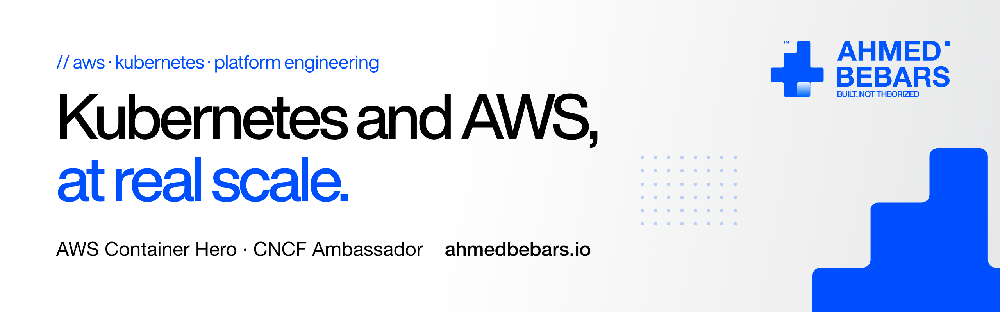

<a href="https://www.ahmedbebars.io">
  <picture>
    <source media="(prefers-color-scheme: dark)" srcset="assets/brand/banner-dark.png">
    
  </picture>
</a>

  
  
  
  
  
  

## Hi, I'm Ahmed Bebars

**AWS Container Hero · CNCF Ambassador.** I serve on the CNCF Technical Oversight Committee (TOC) and the CNCF End User Technical Advisory Board (TAB).

I build developer platforms on Kubernetes and AWS: multi-tenant EKS, golden paths, GPU scheduling, and the guardrails that let hundreds of teams ship without filing a ticket. I go deep for a living. Inside AWS and Kubernetes during the week, underwater on weekends (200+ hours and counting), and I come back up with notes you can use.

## What I'm working on

- **[gpu-eks-workshop](https://github.com/abebars/gpu-eks-workshop)**: hands-on workshop for running GPU workloads on Amazon EKS.
- **[eks-blueprints-example](https://github.com/abebars/eks-blueprints-example)**: a Terraform example for building fully functional EKS clusters.
- **[rollout-marshal](https://github.com/abebars/rollout-marshal)**: agent-run model migration experiments on AWS with feature flags.
- **Community**: organizing [KCD Cairo 2027](https://kcdcairo.com), and before that KCD New York, AWS Community Day New York and the CNCF Midtown NYC meetup.

## Talks

50+ technical talks, from AWS re:Invent to KubeCon. A few recent ones:

| When | Where | Talk |
|:--|:--|:--|
| Sep 2026 | Packt live workshop | Engineering GPU infrastructure for AI workloads |
| Dec 2024 | AWS re:Invent | [Optimizing network efficiency & strengthening multicloud connectivity](https://www.youtube.com/watch?v=t4Hm3ru9TAI) |
| Mar 2024 | KubeCon Europe | [Revolutionizing Mesh Layers: Transitioning from Istio to Cilium](https://www.youtube.com/watch?v=rfImX3V711Q) |
| Dec 2023 | AWS re:Invent | [Platform engineering with Amazon EKS](https://www.youtube.com/watch?v=eLxBnGoBltc) |
| 2023 | AWS This Is My Architecture | [The New York Times: giving developers freedom to deploy while governing at scale](https://www.youtube.com/watch?v=jBffL9zUCSE) |

Full list: [talks](talks/README.md) · Book me to speak: [ahmedbebars.io/talks](https://www.ahmedbebars.io/talks)

## Newsletter and podcast

- **Newsletter**: one deep idea from running Kubernetes on AWS, with the config, the cost and the fix. [Subscribe](https://www.ahmedbebars.io/newsletter)
- **Level Up with Ahmed**: conversations about platforms, careers and the community behind cloud native. [Listen](https://www.ahmedbebars.io/podcast)
- **Writing**: [blog.abebars.io](https://blog.abebars.io)

## Work with me

Platform engineering consulting through **[AB Ventures](https://ab.ventures)**: platform assessments, the paved road on Amazon EKS, and getting real adoption for your internal developer platform.

Speaking, podcast or anything else: [hello@ahmedbebars.io](mailto:hello@ahmedbebars.io)

## Certifications

All 25+ certifications on [Credly](https://www.credly.com/users/abebars).

---

BUILT. NOT THEORIZED. · #LevelUpWithAhmed
